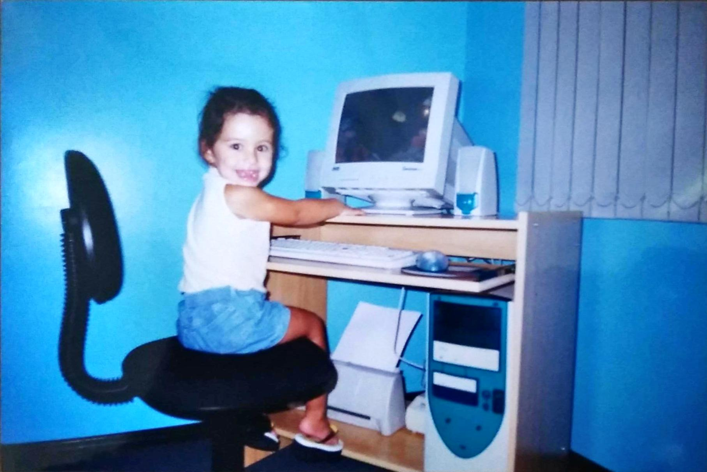
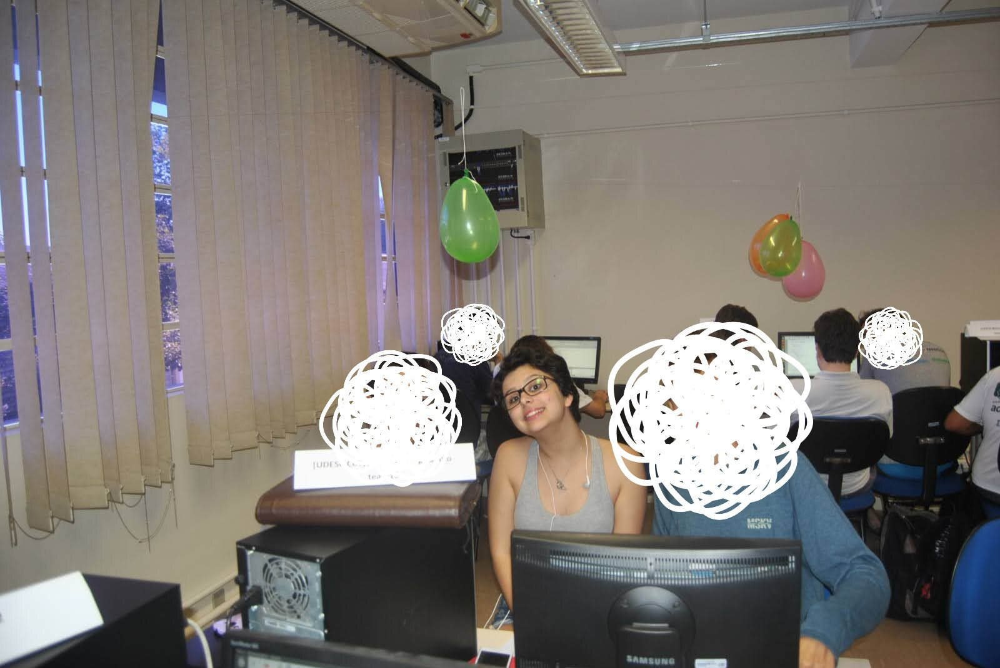
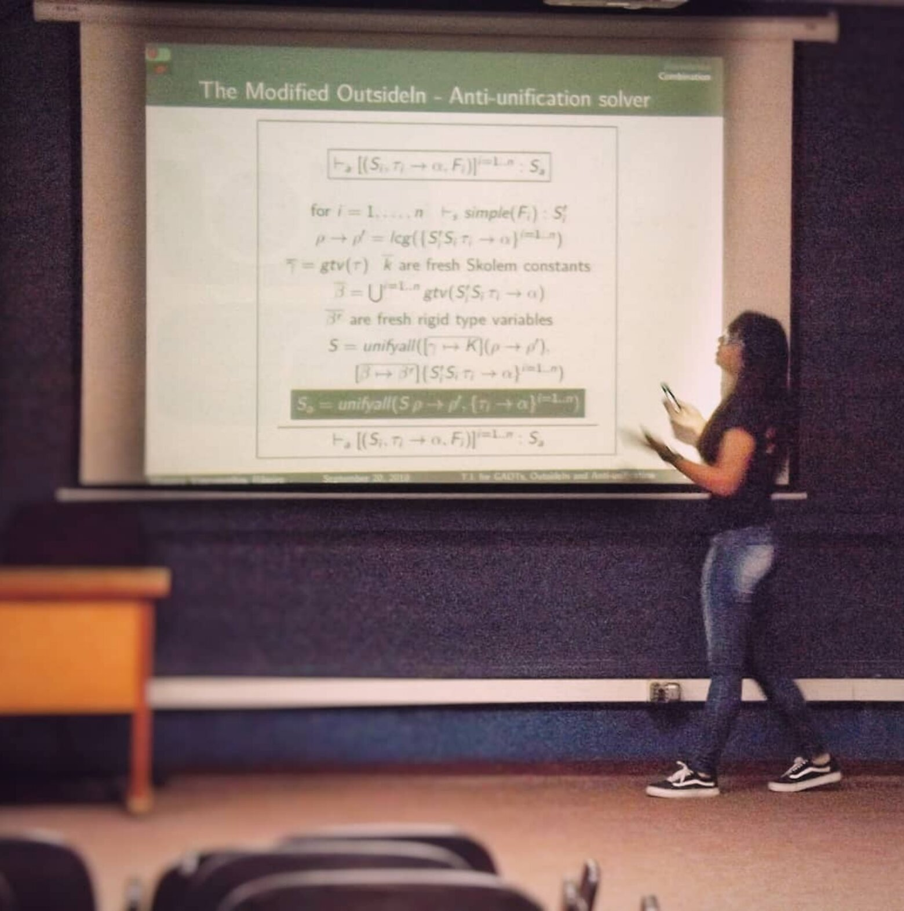
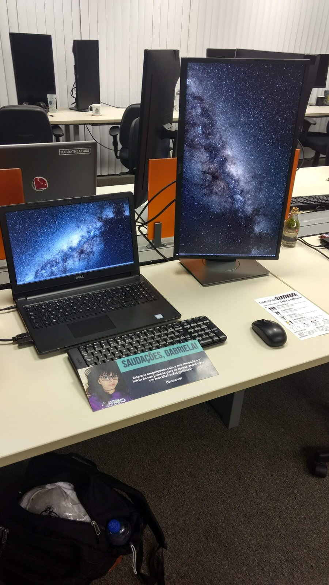
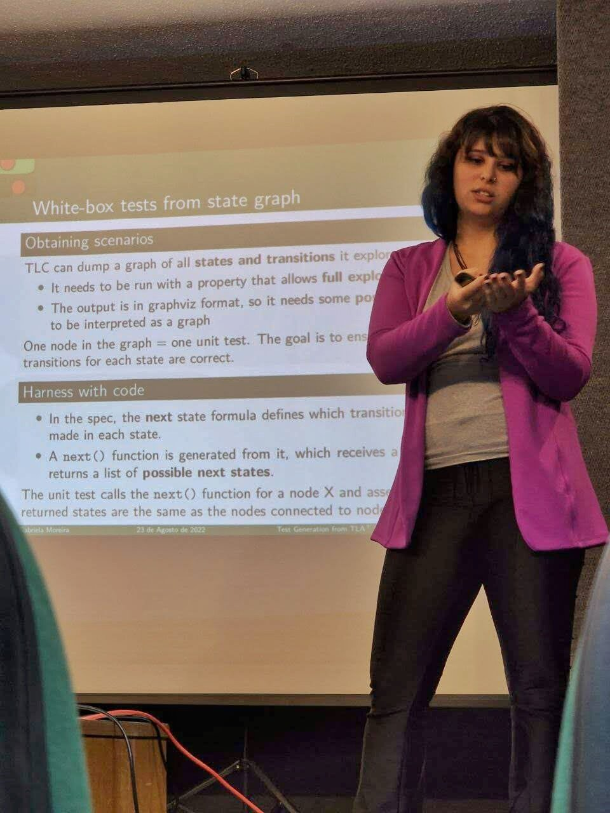
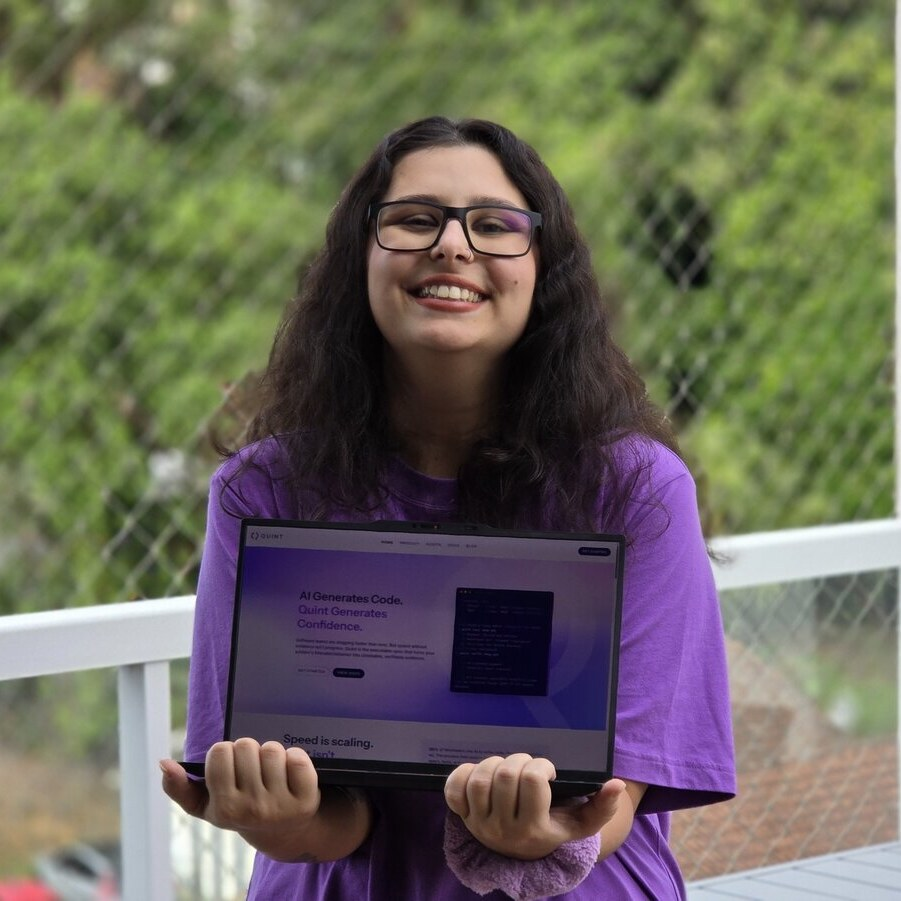

#+title: Gabriela Moreira
#+language: en
#+image: images/me.jpeg

# Homepage. Rendered with pandoc/template-story.html + pandoc/filters/story.lua:
# everything before the ----- rule is the hero (first paragraph
# becomes the big heading); each run of text ending in a captioned image
# becomes one chapter with that photo as a polaroid. Missing photos render
# as placeholders, so just drop the files into images/story/.

Hello!

My name is Gabriela Moreira, I live in Brazil and I really like software. I co-founded a company called [[https://quint.sh/?utm_source=bugarela.com&utm_medium=referral][Quint]] to help other
developers make software trustworthy.

Here's sort of how my professional life went so far.

-----

* Story

I was a little girl who really liked math.

Then I was a teenager who really liked math and computers.

I finished high school and had to pick between math and computers. I picked Computer Science.

#+caption: me just vibing with the fish
#+attr_html: :shift -15px

University started and two things caught my attention on the very first
semester:
- Competitive programming (ICPC). I'm not a competitive person but the team
  work and challenges were really fun!
- Functional programming, because someone gave a talk about Haskell on some
  random event and I got obsessed. I was still learning how to write my
  fibonaccis in C at that time, so I learned _Haskell_ almost as a first
  programming language and that makes it much easier to learn![fn:: They actually
  incorporated this in my university now and students also learn functional
  programming in the first semester per the curriculum, which is great.]

#+caption: probably my first competition
#+attr_html: :shift -30px

A couple of years passed with me having fun, exploring some Linux distros and
nerding out on the corridors. I started taking the class that is actually when
we're supposed to learn Haskell. The professor, Cristiano, was impressed by me
(of course he was, I already knew Haskell). So he invited me to do _research_
with him. First task: read "[[https://homepages.inf.ed.ac.uk/wadler/papers/propositions-as-types/propositions-as-types.pdf][Propositions as Types]]". What a paper! I got hooked,
and my work there can be summarized with these three projects:
- [[https://github.com/bugarela/tipos][Hindley-Milner]]
- [[https://github.com/bugarela/OutsideIn][OutsideIn]]
- [[https://github.com/bugarela/GADTInference][OutsideIn with anti-unification]]

#+caption: presenting my first paper

While working on my research, the coolest company in the city (by my
standards) started approaching me for an _internship_ opportunity. I said no,
busy with research. Then my research finished and I could either start a new
year of it, or take the internship. I was too curious about the cool company,
so I tried it! I started in a data science project, but didn't find that much
fun. After a few months, I changed into a development role and had a really
good time with great teams around me.

#+caption: first day at Magrathea

I was still in the university, and close to having to write my thesis. Then, in perfect timing, over pizza and beer at the office, a colleague
said "I saw something that made me think of you, it's called TLA+, you should
check it out". I googled it and it was love at first sight. For
someone who loved learning logic and was struggling with queues and message
orderings everyday, TLA+ felt like the ultimate thing developers should be
using.

So I wrote my _thesis_ about generating code out of TLA+ specs, which made me
form a really good and somewhat unique mental model of TLA+ specs in my brain.
I started a _masters_ right after this, this time generating tests. I thought that if teams could get code and
tests for free out of a TLA+ spec, they would have a stronger case for spending
work hours writing specs.

#+caption: master's thesis defense

In the middle of my master's though, something unimaginable (for me!) happened.
The TLA+ people started noticing my work. Markus Kuppe said I should apply to
speak at the TLA+ Conference, which I did. You can actually check the [[https://www.youtube.com/watch?v=trm9Lp0yt6Y][video for
this]] (warning: I had a stronger accent back then). That was when Igor
Konnov met me and told me I should apply to work at Informal Systems, a company
that I was aware of and was actively trying to apply TLA+ and test generation
on real engineering teams!

-----

So I joined Informal Systems and they had this idea sort of in a drawer: what
if we had a different _surface syntax_ for TLA+ that addresses all the struggles
we see the engineers having, and that would be too hard or impossible to fix on
the TLA+ tools? Igor asked if I'd like to work on this project, and I couldn't
believe it: Formal methods and programming language theory as a full-time job?
I felt like the luckiest person alive! And I still do.

And that's how Quint started. The team changed, I kept going, and more and more
I learned to stand up for Quint. Upper management learned to trust me. I had
dreams, and they started coming true. Then we started a company, spinning out
of Informal Systems, and my co-founders said "Gabriela, we think you should be
the CEO if you want to." I wanted to.

#+caption: Quint company announcement

